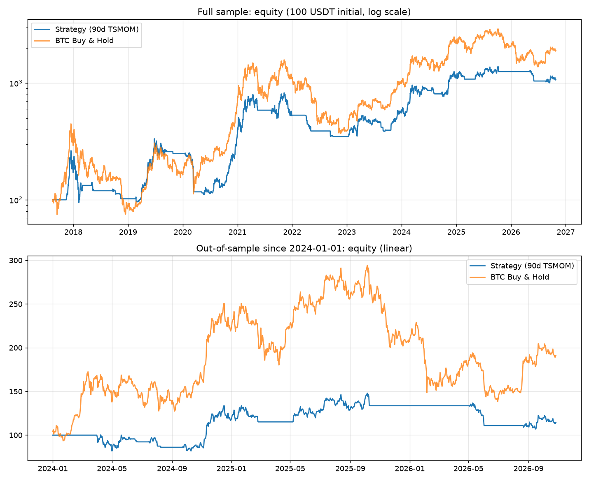

# BTC 90 日动量趋势策略 — 回测报告

- 数据：BTC/USDT 日线，2017-08-17 → 2026-10-27，共 3359 根
- 成本：手续费 0.10% + 滑点 0.05% / 边（往返 0.30%）
- 初始资金：100 USDT ｜ 动量周期：90 日 ｜ 1x、仅做多、日线、信号次日开盘执行

## 全样本表现（2017-08-17 起）

| 指标 | 策略 | BTC 买入持有 | USDT 现金 |
|---|---:|---:|---:|
| 累计收益 | +973.51% | +1795.79% | +0.00% |
| 年化收益（CAGR） | +29.43% | +37.69% | +0.00% |
| 年化波动 | +48.89% | +66.61% | — |
| Sharpe | 0.78 | 0.82 | — |
| 最大回撤 | +66.71% | +83.19% | 0.00% |
| 期末净值 | 1073.51 | 1895.79 | 100.00 |

### 交易统计

| 项 | 数值 |
|---|---:|
| 交易次数（完整买卖） | 59 |
| 胜率 | 35.6% |
| Profit Factor | 2.1055 |
| 手续费+滑点总成本 | 80.39 USDT |
| 持仓时间占比 | 53.1% |

## 样本外表现（2024-01-01 起）

| 指标 | 策略 | BTC 买入持有 | USDT 现金 |
|---|---:|---:|---:|
| 累计收益 | +14.39% | +91.06% | +0.00% |
| 年化收益（CAGR） | +4.88% | +25.79% | +0.00% |
| 年化波动 | +28.09% | +46.79% | — |
| Sharpe | 0.31 | 0.69 | — |
| 最大回撤 | +27.74% | +52.97% | 0.00% |
| 交易次数 | 14 | 0（一次买入） | 0 |
| 胜率 | 35.7% | — | — |
| 成本 | 4.44 USDT | — | — |
| 持仓时间占比 | 48.1% | 100% | 0% |

## 参数稳健性（仅报告，不用于调参）

| 动量周期 | 全样本 CAGR | 全样本 MDD | 全样本 Sharpe | 样本外收益 | 样本外 Sharpe | 样本外 MDD |
|---:|---:|---:|---:|---:|---:|---:|
| 60 | +48.41% | +60.59% | 1.07 | +27.06% | 0.43 | +37.97% |
| 75 | +45.43% | +67.43% | 1.02 | +85.02% | 0.88 | +23.78% |
| 90 | +29.43% | +66.71% | 0.78 | +14.39% | 0.31 | +27.74% |
| 105 | +14.13% | +77.26% | 0.52 | -14.85% | -0.08 | +44.22% |
| 120 | +19.52% | +69.79% | 0.62 | +8.61% | 0.24 | +29.21% |

## 预注册通过标准检查

| 检查项 | 标准 | 结果 | 判定 |
|---|---|---|---|
| 样本外收益（扣成本） | > 0 | +14.39% | ✅ |
| 样本外 Sharpe | > 0.5 | 0.31 | ❌ |
| 最大回撤（全样本） | ≤ 30% | +66.71% | ❌ |
| 对比 BTC 买入持有 | 收益或回撤至少一项明显优势 | 有 | ✅ |
| 参数稳健性（60~120 日） | 相近周期不剧烈恶化 | 未通过 | ❌ |
| 数据与交易时序 | 无未来函数、无数据错误 | 通过 | ✅ |

**综合：未通过初步筛选**

## 数据质量

- 行数：3359；重复日期：0；乱序：0；异常 OHLC：0；日历缺口：0

## 净值曲线

## 结论（诚实版）

- **全样本**：策略 10.7 倍（CAGR +29.4%），BTC 买入持有 19.0 倍（CAGR +37.7%）；策略收益更低，但最大回撤 66.7% 仍远超 30% 门槛，且高于买入持有的 83.2% 只低一些，谈不上优秀。
- **样本外（2024 起）**：策略 +14.4%（CAGR +4.9%、Sharpe 0.31），买入持有 +91.1%（CAGR +25.8%、Sharpe 0.69）；策略回撤（27.7%）明显低于买入持有（53.0%），这是唯一优势。
- **通过标准**：6 项中 3 项不通过（样本外 Sharpe 0.31 < 0.5；全样本 MDD 66.7% > 30%；参数稳健性：105 日周期样本外 -14.9%，结果对周期敏感）。
- **判定：不通过初步筛选**，不建议进入 paper/实盘。

## 说明与限制

- 信号为日线收盘后计算，次日开盘执行，无未来函数；
- 成本只在仓位变化时收取（买卖各一次）；
- 未做空、未加杠杆；初始资金 100 USDT；
- 本报告仅为历史回测，不构成任何投资建议；历史结果不代表未来。
